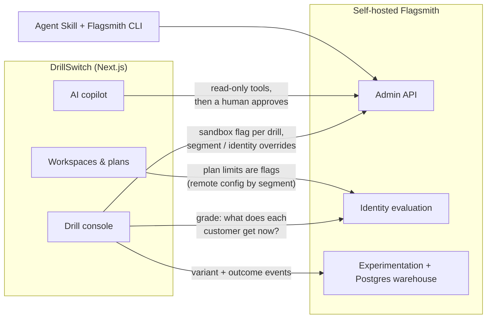

# DrillSwitch

**Incident drills for on-call teams, built on Flagsmith.** Something is on fire in production, and the cause is a feature flag. You have 90 seconds and one change. Turn the flag off for everyone and you cause collateral damage. Target the wrong segment and the incident stays open. Every change is written to a real Flagsmith flag, and Flagsmith's own evaluation decides whether you contained it.

**Live demo: [drillswitch.vercel.app](https://drillswitch.vercel.app)**. It runs on free tiers: Vercel, Flagsmith Cloud and Neon Postgres. The repo also runs fully self-hosted with `./setup.sh`.

Built by team **Shooting Stars** (Saikiran K and Deblina Datta) for the WeMakeDevs × Flagsmith **Toggle Wars** hackathon. One project, all four tracks.

```bash
git clone https://github.com/Sai-Kiran-Karjala/drillswitch.git && cd drillswitch
./setup.sh                      # self-hosted Flagsmith + database + config, about a minute
cd web && npm run dev           # http://localhost:3100
```

## What you can do

| | |
|---|---|
| **Run a drill** | Five built-in incidents, each needing a different Flagsmith move: a segment override, an identity override for one customer, the environment default (an existing staff override keeps working), or turning a fallback **on** for one region. |
| **See who it hits before you apply** | Half of all players get a live blast-radius preview. Whether that helps is the A/B test below. |
| **Drill your team** | Sign up, create a workspace, invite your on-call rotation. The readiness dashboard shows who has landed a scoped fix, who caused collateral damage, and which kinds of incident nobody has practised yet. |
| **Write your own drills** | On the Team plan, describe an incident with your own flag, segments and customers. The editor checks as you type that one change can win it, and shows that change. |
| **Page the AI copilot** | Gemini investigates the incident with read-only Flagsmith tools and proposes one change. Nothing is written until a person approves it. |
| **Put out a real fire from the terminal** | An Agent Skill that walks a coding agent through containing a flag-caused incident with the Flagsmith CLI. |

## How it uses Flagsmith



- **Every drill gets its own throwaway flag** (`drill_<id>`), created through the admin API in the drill's starting state, including any overrides that already exist. It's deleted automatically.
- **Grading is Flagsmith's answer, not ours.** After your change, each customer is evaluated as a Flagsmith identity with their traits. Affected customers must reach the safe state, and healthy customers must keep the state they had.
- **The experiment runs on Flagsmith Experimentation.** The `drill_console` flag splits players between the runbook (A) and runbook plus blast-radius preview (B). Outcome events go to Flagsmith's Postgres warehouse, and the results page reads Flagsmith's own Bayesian analysis.
- **Pricing plans are flags.** `max_members`, `drill_history_days`, `byo_flagsmith` and `custom_drills` are remote-config flags with a `team_plan` segment override. Each workspace is evaluated as an identity whose `workspace_plan` trait sets its plan. Change a value in Flagsmith and every workspace's limits change with it.
- **Bring your own Flagsmith (Team plan).** A workspace can connect its own Flagsmith organisation. Its key is encrypted with AES-256-GCM, and drills then run in that workspace's own project.

## The four tracks

### Track 1: Test Something Real
**Hypothesis:** a live blast-radius preview increases correct, first-attempt scoped rollbacks within 90 seconds.
A/B test on the `drill_console` flag with two metrics: `scoped_recovery_verified` (higher is better) and `healthy_customers_broken` (lower is better). Real players and simulated players run in separate Flagsmith environments, so their results never mix. `/results` shows both, straight from Flagsmith. The simulator (`npm run simulate`) proves the pipeline works end to end. Its behaviour model is scripted, so it isn't evidence about people; the *Real players* tab is.

### Track 2: AI Agents and Feature Flags
`/copilot`: Gemini (free tier, via the Interactions API) gets the incident brief but isn't told who is affected. Its tools are read-only calls to Flagsmith: `get_flag_state`, `evaluate_identities` (real identity evaluation), `list_segments` and `preview_change`. It finishes with `propose_change`, which only records a proposal. **A person approves** in a confirmation dialog after seeing the predicted effect on every customer. Only then is the change written to Flagsmith and graded. In our tests it chose the right change on all five built-in incidents in 2 to 22 seconds. Copilot runs are kept out of the A/B test and team stats.

### Track 3: Build on Open Source Flagsmith
Everything runs on self-hosted, open-source Flagsmith: the experiment and its Postgres warehouse, the per-drill flags, identity evaluation, and plans as flags. `./setup.sh` goes from a fresh clone to a configured instance in about a minute, and it's safe to run again. Hosted workspaces get their own Production and Staging *environments*, because self-hosted Flagsmith's free licence allows one project per organisation and we work within that rather than around it.

### Track 4: Flagsmith Agent Skills
[`skills/put-out-the-fire`](skills/put-out-the-fire/SKILL.md) works as follows:
1. Trace a symptom to the flag in the code.
2. Confirm it with `flagsmith eval`.
3. Pick the narrowest segment.
4. Show the blast radius and **wait for a human yes**.
5. Apply the change, verify it, and leave a trail: the feature description, an incident note, and the rollback command.

The CLI's own Production confirmation is a second gate: the skill may pass `--yes` only after the person has answered. `scripts/stage-incident.sh` stages a demo incident on a local instance.

## Project layout

```
setup.sh                     one-command local setup
infra/                       Docker Compose: Flagsmith (API, UI, task processor, Postgres) + app database
web/                         Next.js 16 app (App Router, shadcn/ui)
  src/lib/drill/             scenario model, local evaluator/grader/solver, Flagsmith admin client, sessions
  src/lib/copilot/agent.ts   the AI copilot (Gemini + read-only Flagsmith tools)
  src/lib/saas/              workspaces (Clerk), plans as flags, BYO Flagsmith, app database
  scripts/bootstrap.mjs      configures Flagsmith for DrillSwitch (called by setup.sh)
  scripts/simulate.ts        simulated players for the experiment pipeline
skills/put-out-the-fire/     the Agent Skill, a demo incident and its shop code
```

## Deployment

The live demo runs the same code on Vercel (app), Flagsmith Cloud (flags, segments, identities, experiments) and Neon (app database). The app adapts to either kind of Flagsmith:
- **Versioned environments:** with v2 feature versioning (the Flagsmith Cloud default), changes are published as versions.
- **Edge identities:** Flagsmith Cloud's identities are used for identity overrides.
- **Grading on Cloud:** grading waits for the edge API to reflect a change before reading Flagsmith's answer.
- **Serverless state:** drill sessions live in Postgres, so any serverless instance can serve any drill.

To configure a Flagsmith Cloud project, run `FLAGSMITH_URL=https://api.flagsmith.com FLAGSMITH_API_KEY=<organisation admin key> node web/scripts/bootstrap.mjs`.

## Configuration

`./setup.sh` writes everything required to `web/.env.local`, `infra/.admin.env` and `infra/flagsmith.env`. All three are gitignored and readable only by you. Two features are optional and stay off until you add their keys to `web/.env.local` (see [`web/.env.example`](web/.env.example)):

- **Team workspaces:** a [Clerk](https://clerk.com) application (`NEXT_PUBLIC_CLERK_PUBLISHABLE_KEY`, `CLERK_SECRET_KEY`). Without it, the app runs as a single-player demo.
- **AI copilot:** a free [Gemini API key](https://aistudio.google.com/apikey) (`GEMINI_API_KEY`). On the free tier, Google may use prompts to improve its products; drills only contain made-up customers.

Ports can be moved with `FLAGSMITH_PORT`, `FLAGSMITH_PROCESSOR_PORT` and `APPDB_PORT` when running `./setup.sh`.

## Notes and limits

- Drills use made-up customers and throwaway flags. Nothing touches a real production system.
- Payments are not implemented. The Team plan is a demo upgrade, but its limits are real Flagsmith flags.
- Things we found in Flagsmith along the way, reported as hackathon feedback:
  - The CLI's `--priority 0` fails with "Duplicate priority" when another override holds priority 0 (`flag reorder` works).
  - `flagsmith eval` needs the SDK URL set to the host root.
  - `/api/v1/audit/` returns a 500 when called with an organisation API key.

## License

[MIT](LICENSE)
